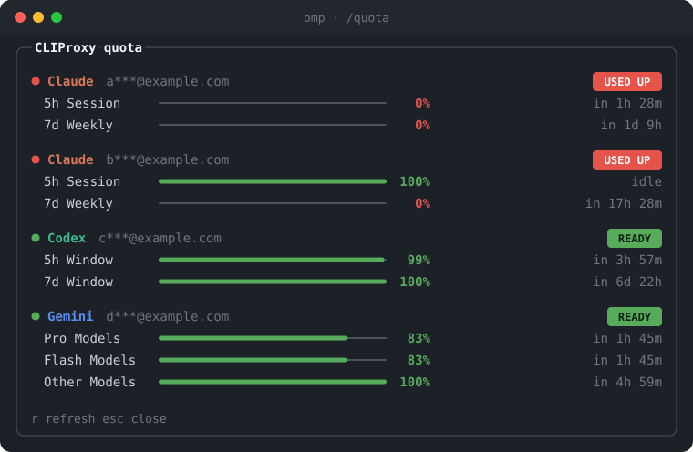

# omp-cliproxy-quota

See the quota of every CLIProxyAPI account without leaving [omp](https://github.com/can1357/oh-my-pi).
The package has two parts. Use one or both.

| Part | Command | Result |
|---|---|---|
| Usage provider | `omp usage`, `/usage` | The proxy accounts appear in the built-in omp usage display, with history. |
| Dashboard | `/quota` | A framed panel with a bar for each quota window and a status chip for each account. |

<p align="center">
  
</p>

<p align="center"><sub>A rendered preview of the `/quota` panel with made-up accounts.</sub></p>

Green means 70% or more is left. Yellow means 30% to 69%. Red means less than 30%.

## Why this exists

`omp usage` shows limits only for accounts that you add with `/login`.
A CLIProxyAPI model uses an API key, so omp has no account to ask.
The real accounts live on the proxy. This extension reads them from the proxy.

## Requirements

| Item | Version |
|---|---|
| omp | 18.6 or later |
| CLIProxyAPI | with the `pi-bridge` plugin enabled |
| A proxy provider in `models.yml` | `baseUrl` and `apiKey` set |

The [pi-bridge plugin](https://github.com/abix5/pi-cliproxyapi-bridge) adds the quota route to the proxy.
It uses your normal API key. It needs no management key.

## Install

```sh
git clone git@github.com:Benny-Gil/omp-cliproxy-quota.git
cd omp-cliproxy-quota
./install.sh
```

The script copies both extensions to `~/.omp/agent/extensions/`.
Omp loads every file in that folder at start.

The usage provider needs one more step. Omp asks a provider for usage only when it holds a credential for that provider.
Your key sits in `models.yml`, so run this script once:

```sh
./setup-credentials.py
```

The script copies the key from `models.yml` into the omp credential store for `cliproxy`, `cliproxy-claude` and `cliproxy-gemini`.
It saves a backup of `agent.db` first. It skips a provider that has a credential.
Start a new omp session after the install.

Add `--with-cli` to also install `cliquota`, a terminal command with the same output:

```sh
./install.sh --with-cli
```

## Use

| Command | Result |
|---|---|
| `omp usage` | Shows the proxy accounts with the other providers. Add `-p cliproxy-claude` to filter. |
| `omp usage --history` | Shows the hourly snapshots that omp recorded. |
| `/usage` | The same display inside a session. |
| `/quota` | Opens the dashboard panel. The bridge returns data that is up to two minutes old. |
| `/quota -r` | Asks the bridge for a fresh read. |
| `r` in the panel | Refreshes without closing the panel. |
| `esc` or `q` in the panel | Closes the panel. |
| `cliquota` | Same output in a plain terminal. |
| `cliquota -r` | Same fresh read in a plain terminal. |

## How it works

The usage provider registers a `usage` handler for each proxy provider through `pi.registerProvider`.
Omp calls the handler with the stored credential. The handler calls the bridge and keeps the accounts that its provider serves:

| Omp provider | Proxy accounts |
|---|---|
| `cliproxy-claude` | `claude` |
| `cliproxy` | `codex` |
| `cliproxy-gemini` | `antigravity` |

Omp then caches the report and records the history.

The `/quota` command works alone:

1. The extension reads `baseUrl` and `apiKey` from `~/.omp/agent/models.yml`.
2. It sends `GET /v0/resource/plugins/pi-bridge/usage` with your API key.
3. It draws one bar for each quota window and shows when the window resets.

The extension stores no key. It does not write any file.
It sends the key only to the proxy address in your own `models.yml`.

The extension takes the first `baseUrl` and the first `apiKey` that it finds in `models.yml`.
Put your proxy provider first in the file, or all your proxy providers must share one key.

## Check the bridge

Run this command. Replace the two values.

```sh
curl -H "Authorization: Bearer <api-key>" \
  http://<proxy-host>:8317/v0/resource/plugins/pi-bridge/capabilities
```

A working bridge returns JSON with `"plugin":"pi-bridge"`.

## Troubleshooting

| Message | Cause | Action |
|---|---|---|
| `quota: HTTP 404. Is pi-bridge enabled on the proxy?` | The plugin is not installed. | Install `pi-bridge` on the proxy. |
| `quota: HTTP 401` | The key is not valid for the proxy. | Check `apiKey` in `models.yml`. |
| `quota: no cliproxy baseUrl or apiKey in models.yml` | The extension cannot find the proxy. | Add a provider with `baseUrl` and `apiKey`. |
| `No credentials found for provider` | Omp has no credential for the provider. | Run `./setup-credentials.py`. |
| `/quota` does not exist | Omp did not load the extension. | Start a new omp session. Check the file in `~/.omp/agent/extensions/`. |
| The panel shows no colours | Your terminal does not support true colour. | Use a terminal that does, or open an issue. |
| A Claude account shows `● error` | The account has no quota left, or the proxy cannot use it. | Wait for the reset time, or check the account on the proxy. |

## Security

- The bridge masks account emails before it sends them.
- The bridge is a native plugin that runs inside the proxy process. Read its source before you load it.
- `allow_all_api_keys: true` lets every key holder read the masked quota. Set it to match your trust level.

## Layout

```
docs/quota.svg                 the preview image
extensions/cliproxy-usage.ts   the usage provider for omp usage and /usage
extensions/cliproxy-quota.ts   the /quota command for omp
setup-credentials.py           stores the key as an omp credential
cliquota                       the same report as a terminal command
install.sh                     copies the files into place
```

## Status

This is a private tool for personal use. It has no licence and no tests.
The extension API of omp is not stable, so a new omp release can break it.
